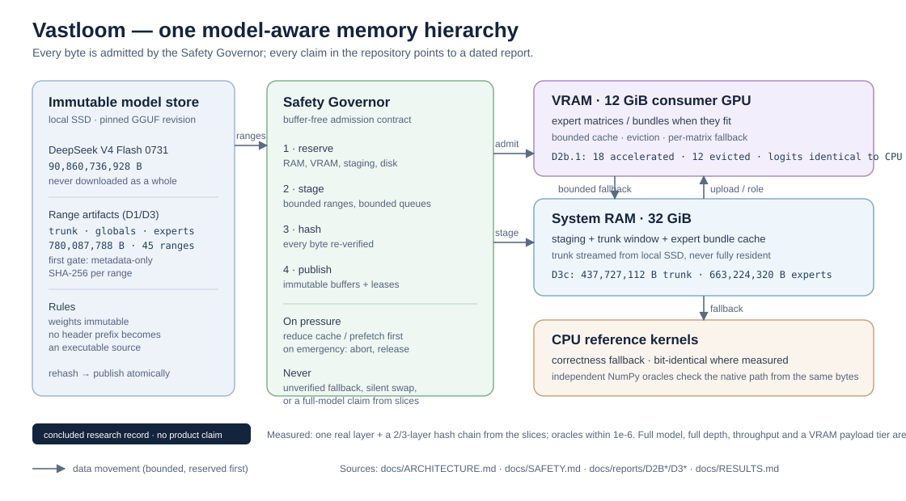

# Vastloom in two minutes

A research record, not a product. If you are here to see what was built and whether it worked,
this page is the shortest honest answer; the dated evidence is linked at the bottom.

## The question

Can a 90.86 GB Mixture-of-Experts model be studied on a consumer machine with **12 GiB of VRAM and
32 GiB of RAM** without downloading the whole checkpoint, while keeping every byte verified and
every claim reproducible?

Vastloom treats VRAM, system RAM and NVMe as one model-aware hierarchy. A Safety Governor reserves
memory *before* it is allocated, every queue and buffer is bounded, original weights stay immutable,
and emergency pressure aborts work instead of risking the host. The project is over; the record
stays.



## What was built

- A native C++20 runtime (plus Python tooling) with a reservation-based Safety Governor, bounded
  NVMe-to-RAM streaming, a routing-aware expert cache and a CUDA Driver API boundary.
- A **reduced-payload method** for the pinned DeepSeek V4 Flash 0731 `UD-IQ2_XXS` checkpoint:
  metadata-only identities, exact HTTP-range artifacts and SHA-256 per range — **780,087,788 B in
  45 ranges** instead of a 90.86 GB download.
- A real executor for one layer and for a 2/3-layer hash-routed chain, including a five-token
  prefill that opens the layer-2 4:1 compressed window.
- **Independent NumPy oracles** that read the same artifact bytes, dequantize them with their own
  code and recompute the layer/chain — so a wiring bug cannot hide behind self-consistency.

## What actually ran

Real captured output, no mockups. The tiny fixture is bundled; the DeepSeek slice needs the
imported artifacts described in `docs/USAGE.md`.

```text
> vastloom version
0.5.0-alpha.1

> vastloom doctor
CPU:      AMD64 Family 25 Model 97 Stepping 2, AuthenticAMD (24 logical cores)
ISA:      AVX2=yes FMA=yes AVX-512F=yes
RAM:      31.11 GiB total, 17.93 GiB available
GPU:      NVIDIA GeForce RTX 4070 SUPER [CUDA] — 11.99 GiB total, 9.48 GiB free

> vastloom self-test examples/models/vastloom-tinychat-v1.sgtm
PASS  Ciao
PASS  Quanto fa 2+2?
PASS  Qual è la capitale d'Italia?
PASS  Sei online?
PASS  What is 2+2?
Result: PASS (16.08 ms)
```

One real DeepSeek layer from official range payload (abridged JSON; full output in the
[D2 report](reports/D2_IQ2XXS_LAYER0_RANGE_EXECUTION.md)):

```json
{"ok":true,"complete_model":false,"executed_layers":1,"model_layers":43,
 "logits":129280,"logit_minimum":-16.1273,"logit_maximum":15.5206,
 "argmax_token":30528,"experts_executed":[254,222,245,200,53,35],
 "expert_bytes_read":45219840,"trunk_bytes":138867160,"global_bytes":596000788}
```

The independent NumPy oracle on the same bytes (full output in the
[D2b.2 report](reports/D2B_LAYER0_ORACLE_VALIDATION.md)):

```text
logits PASS (129280 values, max abs diff 9.53674316e-07)
final hidden PASS (4096 values, max abs diff 4.76837158e-07)
argmax 30528 · route [254, 222, 245, 200, 53, 35]
```

A five-token prompt through three layers, with the layer-2 compressed window open
([D3c report](reports/D3C_MULTITOKEN_ORACLE_VALIDATION.md)):

```json
{"ok":true,"complete_model":false,"executed_layers":3,"model_layers":43,
 "tokens":[0,1,2,3,4],"logits":129280,"argmax_token":20267,
 "trunk_bytes_read":437727112,"expert_bytes_read":663224320,
 "relocated_tensors":343,"relocated_expert_bundles":88}
```

```text
oracle: logits max|delta|=1.90734863e-06 · hidden max|delta|=5.96046448e-08
route per layer/token: 15/15 identical · compressed window: 1 row, 6 slots/token
```

## The numbers that matter

| Claim | Measured | Where |
|---|---|---|
| Verified range payload instead of the 90.86 GB checkpoint | 780,087,788 B / 45 ranges | [D2](reports/D2_IQ2XXS_LAYER0_RANGE_EXECUTION.md) |
| Real DeepSeek layers executed from that payload | 1 layer, then a deterministic 3-layer chain | [D2](reports/D2_IQ2XXS_LAYER0_RANGE_EXECUTION.md), [D3](reports/D3_HASH_CHAIN_VALIDATION.md) |
| Independent layer-0 oracle | logits within 9.54e-07 | [D2b.2](reports/D2B_LAYER0_ORACLE_VALIDATION.md) |
| Independent chain oracle (tokens 0/1, depths 1–3) | logits within 1.91e-06 | [D3b](reports/D3B_CHAIN_ORACLE_VALIDATION.md) |
| Multi-token + real 4:1 compressed window | logits within 1.91e-06, hidden within 5.96e-08 | [D3c](reports/D3C_MULTITOKEN_ORACLE_VALIDATION.md) |
| Device expert residency vs CPU reference | bit-identical logits (max abs diff 0.0) | [D2b.1](reports/D2B_DEVICE_RESIDENCY_VALIDATION.md) |

## What did not work, and is not claimed

- **No full-model result.** The DeepSeek track runs one layer and a three-layer chain; ratio-128
  layers, learned-router layers and full depth are not implemented.
- **No throughput win.** On the historical Qwen3.8 track the runtime was roughly ten to twelve
  times slower than llama.cpp in the measured CPU regime; that is recorded as a negative result,
  not hidden.
- **No VRAM payload tier.** D2b.1 is device matrix residency with CPU fallback; expert bundles
  still pass through governed RAM first. `ResidencyObject` VRAM transitions remain unused.
- **No large checkpoint in the repository, and no full download in the method.** Range slices and
  header-only metadata are the point.
- **No GIF/video in this showcase.** The author's current connection and local state do not allow
  recording a large-model demo; the terminal output above is from the dated runs and the commands
  are documented for reproduction.

## What the project demonstrates

- Reading and validating a binary model format end to end: GGUF metadata, tensor tables, quantized
  matrix storage, HTTP ranges, SHA-256, immutable publication.
- Designing memory-safe systems under a hard budget: reservations before allocation, bounded
  queues/caches, leases, fail-closed behavior, deterministic refusals.
- Building verification instruments instead of trusting self-consistency: independent oracles,
  declared tolerances, pinned external parity where available.
- Reporting results honestly, including negative ones, with hardware, cache state and byte
  accounting recorded.

## Start here

- **5 minutes**: this page, then [RESULTS.md](RESULTS.md) for the measured position.
- **30 minutes**: [DEEPSEEK_V4_FLASH.md](DEEPSEEK_V4_FLASH.md) for the reduced-payload story,
  [ARCHITECTURE.md](ARCHITECTURE.md) for the control/data plane.
- **Deep dive**: the dated reports in [reports/](reports/README.md), the roadmap in
  [ROADMAP.md](ROADMAP.md), and the resume backlog in
  [planning/FUTURE_WORK.md](planning/FUTURE_WORK.md).

## See it run in two minutes

Everything below needs no downloaded model:

```bash
cmake --preset release
cmake --build --preset release --parallel
ctest --preset release
./scripts/demo.sh          # Windows: pwsh scripts/demo.ps1
```

The demo runs `version`, `doctor` and the bundled TinyTransformer self-test. The optional SmolLM2
path (269 MB public checkpoint, JSON-object serving) is documented in [USAGE.md](USAGE.md); it is
not required to reproduce any claim on this page.

---

*Vastloom is concluded research software, provided without warranty. Every number here is a dated
record of the run that produced it; the report is the authority, not this summary.*
